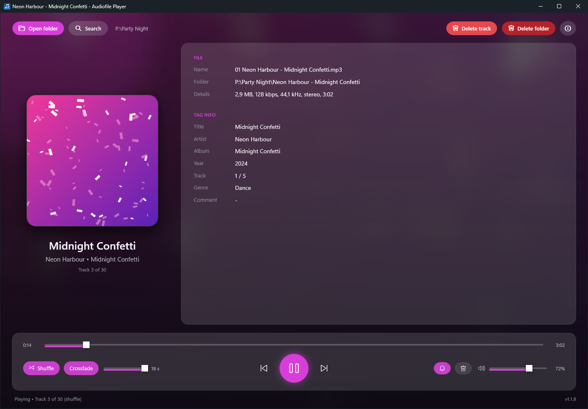

# Audiofile Player

[](https://github.com/kreaton/AudiofilePlayer/releases/latest)
[](LICENSE)


[](https://github.com/kreaton/AudiofilePlayer/stargazers)

⭐ If Audiofile Player earns a place on your machine, [star it on GitHub](https://github.com/kreaton/AudiofilePlayer) — it's free, made by one developer, and stars are how other people find it.


**A music player for Windows that plays every music file in a folder and all its subfolders.**

There's no library to build: open a folder and listen. If a track or album turns out not to be worth keeping, you can clean it up while it plays.

▶️ **[Watch the video on YouTube](https://youtu.be/4q4kQakzi_c)**

## Install

**[Download the installer](https://github.com/kreaton/AudiofilePlayer/releases/latest/download/AudiofilePlayer-win-Setup.exe)** and run it. If your PC doesn't have the .NET 10 Desktop Runtime yet, the installer adds it.

The installer isn't code-signed, so Windows may warn you about it. To continue, choose **More info → Run anyway**.

To get a newer version later, click the ⓘ button and choose **Check for updates**. To remove the app, use **Settings → Apps → Installed apps** in Windows.

**Coming from MP3 Player?** The app used to be called MP3 Player. Version 1.1.8 and older can't update to Audiofile Player by themselves, so install it with the link above and then uninstall MP3 Player in **Settings → Apps → Installed apps**. Your folder, volume and options carry over.

## What it does

- **Plays whole folders:** pick a folder and every music file under it goes into the playlist.
- **Many formats:** MP3, M4A/AAC, WMA, FLAC, WAV and AIFF, plus OGG and Opus when Windows has a decoder for them (the free Web Media Extensions from the Microsoft Store). A file that can't be decoded is skipped, with a note in the status bar. Tags and cover art are read from all of them. Surround (5.1, 7.1) files are mixed down to stereo.
- **Drag and drop:** drop a folder on the window to play it. Drop a music file and its folder becomes the playlist, starting with that track. Drop any other kind of file and its folder opens, but nothing starts playing.
- **Open with:** the installer adds the player to Explorer's **Open with** menu for all these file types, and it works the same way as dropping the file. If the player is already running, the file opens in the window you already have instead of in a second player.
- **Shuffle:** every track plays once in random order before any track repeats.
- **Crossfade:** blends the end of one track into the start of the next, over 1 to 18 seconds.
- **Search:** type part of an artist, album or song title to find a track and play it.
- **Track details:** shows the title, artist, album and cover art, and the window takes its accent color from the cover.
- **Clean-up while you listen:** delete the current track, or the whole folder it's in (usually an album). Both ask first and send the files to the Recycle Bin. You can't delete the folder for tracks that sit directly in the folder you opened. To delete tracks without being asked, turn on the trash-can toggle at the bottom right; deleting a folder always asks.
- **Taskbar controls:** hover over the taskbar icon for delete, previous, play/pause and next buttons.
- **Windows media controls:** the player shows up in the Windows media overlay, Quick Settings and the lock screen, with the track, cover art and a progress bar. The keyboard's media keys work even when the player is in the background.
- **Now-playing notification:** turn on the bell at the bottom right to get a silent notification when a new track starts while the player is in the background.
- **Remembers your settings:** your last folder, volume, shuffle, crossfade and the toggles are still there next time.



## Keyboard shortcuts

| Key | Action |
|---|---|
| Space | Play / pause |
| Ctrl+Right | Next track |
| Ctrl+Left | Previous track, or back to the start if the track has played for more than 3 seconds |
| Right / Left | Forward / back 5 seconds |
| Up / Down | Volume up / down 5% |
| S | Shuffle on / off |
| Ctrl+F | Search |
| F1 | This list of shortcuts, inside the app |
| Media keys (⏯ ⏮ ⏭ on the keyboard) | Play/pause, previous and next, even when the player is in the background. Only if your keyboard has them; on some keyboards they need Fn. |
| Win+A | No media keys? Windows Quick Settings shows the player's play/pause, previous and next, from any app |

Space always means play/pause, even right after you've clicked a button. To press a focused button from the keyboard, use Enter.

## Searching

Type to narrow the list. Up and Down select a track, Enter plays it and Esc closes the window. You can also double-click a track.

Words can be in any order and accents are ignored, so `tears bonnie` finds "Save Up All Your Tears" by Bonnie Tyler.

---

## For developers

| Project | Description |
|---|---|
| `AudiofilePlayer.Core` | The UI-independent player: audio engine with crossfading, playlist and shuffle, tag reading and settings. See its [API reference](AudiofilePlayer.Core/README.md). |
| `AudiofilePlayer.Wpf` | WPF front end with the Fluent theme (`AudiofilePlayer.exe`). |
| `promo-video` | Promo videos made with Remotion. See its [README](promo-video/README.md). |

The player uses [NAudio](https://github.com/naudio/NAudio) 2.2.1 for decoding and playback, and [TagLibSharp](https://github.com/mono/taglib-sharp) 2.3.0 for ID3 tags and cover art. Settings are saved to `%AppData%\Mp3Player\settings.json`.

### Build and run

You need the [.NET 10 SDK](https://dotnet.microsoft.com/download). You can also open `AudiofilePlayer.slnx` in a Visual Studio version that supports .NET 10, with `AudiofilePlayer.Wpf` as the startup project.

```bash
dotnet build AudiofilePlayer.slnx
```

```bash
dotnet run --project AudiofilePlayer.Wpf
```

The app takes an optional folder or file path. With a folder, that folder opens and playback starts right away. With a music file, its folder opens and playback starts with that file. If the player is already running, the path goes to that window instead:

```bash
dotnet run --project AudiofilePlayer.Wpf -- "D:\Music\Some Album"
```

```bash
dotnet run --project AudiofilePlayer.Wpf -- "D:\Music\Some Album\03 Some Track.mp3"
```

### Releases

Every push to `main` builds the app on GitHub Actions and publishes a new release, one patch version higher than the last (`.github/workflows/release.yml`). To push without releasing, add `[skip ci]` to the commit message. You can also start a release by hand from the repository's Actions tab.

The repository must stay public, because **Check for updates** reads its releases without logging in.

## License & Authorship

This project is distributed under the terms of the [MIT License](LICENSE).

**AI authorship note:** Most of the source code in this repository was generated with AI coding agents (Claude Code), under my direction and review. Purely AI-generated material may not be eligible for copyright protection in some jurisdictions. To the extent any part of this project is protected by copyright, it is licensed under the MIT License, and the license's warranty and liability disclaimers apply to the project as a whole.

<!-- notices:start -->
### Independent development

Audiofile Player is an independent, personal project developed by Per Hejndorf. It is not affiliated with, endorsed by or sponsored by Microsoft or any other rights holder. Product names and logos are trademarks of their respective owners and are used only to identify the services and tools the project works with.

### Third-party notices and asset provenance

[THIRD-PARTY-NOTICES.md](THIRD-PARTY-NOTICES.md) lists every third-party library, font and online service the project uses, with version, licence, source and whether it was modified. It also records where the icons, images, audio and video came from and how they are licensed.
<!-- notices:end -->
